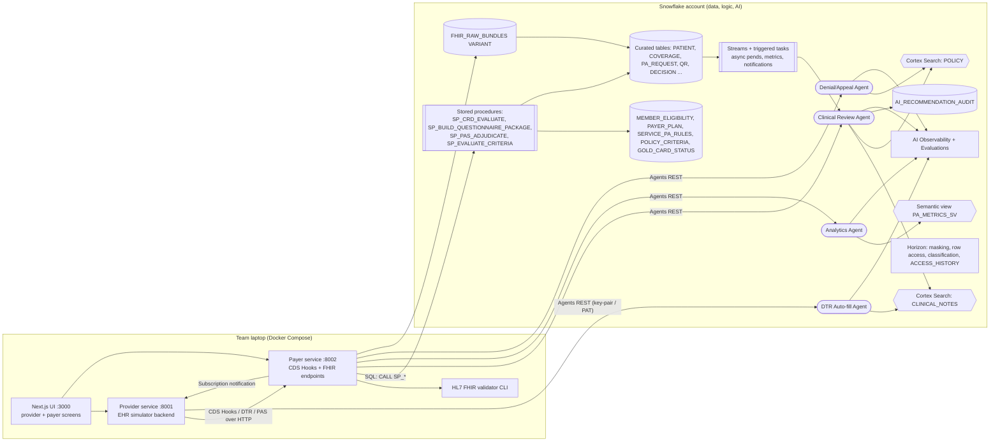
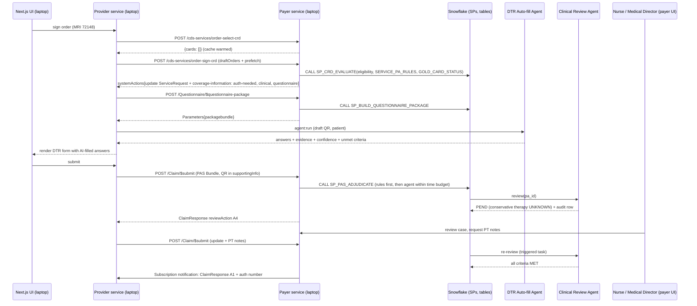

# PRD: AuthBridge, prior authorization with Snowflake agents

| Field | Value |
|---|---|
| Product (working name) | **AuthBridge**: standards-native electronic prior authorization (ePA) on Snowflake Cortex AI. Alternatives: "ClearAuth", "PriorPath". Check trademarks before using any of them publicly. |
| Document | Product Requirements Document (PRD), hackathon edition |
| Version | 1.1 (architecture revised: application tier runs locally; Snowflake is the data, logic and AI tier) |
| Date | October 18, 2026 |
| Status | Draft for team review (Abhiram's team) |
| Team stack decisions | React/Next.js front end plus two backend services (provider and payer) running **locally on team laptops** via Docker Compose. Snowflake hosts all data, payer rules (stored procedures), Cortex AI and governance. SPCS / App Runtime hosting is a week-3 stretch, not a dependency. Da Vinci CRD + DTR + PAS followed faithfully. Four Cortex Agents: DTR auto-fill, payer clinical review, analytics, and denial/appeal explainer. Timeline is 3+ weeks. |
| Data policy | **Synthetic data only.** No real PHI. |

**Bottom line.** AuthBridge should be built as a standards-faithful Da Vinci CRD → DTR → PAS loop. All payer data, eligibility and PA rules, evidence retrieval, AI review and CMS metrics run inside Snowflake; thin provider and payer services run locally and only translate FHIR/CDS Hooks traffic into Snowflake calls. The AI follows one deliberately asymmetric rule: it can auto-approve when every criterion is met and backed by cited evidence, it can pend with a specific document request, and it can only *recommend* denial to a licensed clinician. The timing is right. CMS-0057-F decision deadlines (72 hours expedited, 7 days standard), specific denial reasons and public metrics have been in force since January 1, 2026, and FHIR Prior Authorization APIs become mandatory on January 1, 2027 ([CMS](https://www.cms.gov/newsroom/fact-sheets/cms-interoperability-and-prior-authorization-final-rule-cms-0057-f)). Only **40%** of medical PA is fully electronic today ([CAQH 2025 Index](https://index.caqh.org/hubfs/Index/CAQH_IndexReport_2025_Executive%20Report_v6.pdf)). The team's original flow is directionally right but has six spec deviations that judges familiar with Da Vinci will notice:
- a raw Bundle POST instead of a CDS Hooks request;
- `order-select` treated as authoritative;
- coverage results shown as cards instead of a systemAction;
- no `$questionnaire-package` call;
- `$submit` on the QuestionnaireResponse instead of `Claim/$submit`;
- approve/deny instead of X12 review-action codes.

Fixing these, while keeping all numeric thresholds in SQL rather than in the LLM, gives the team a demo that is both technically correct and defensible under California SB 1120, Texas SB 815 and CMS Medicare Advantage rules.

---

## 1. Executive summary

**One-liner:** *AuthBridge tells clinicians in real time whether prior authorization is needed, pre-fills the payer's questionnaire from the chart with cited evidence, and gives payer reviewers an AI-assembled, criterion-by-criterion case. Clinicians make every adverse decision, and every byte of data and every AI call stays inside Snowflake.*

AuthBridge has two faces backed by one Snowflake account. Both faces are served by a Next.js UI and two lightweight backend services that run on a developer laptop; neither service stores data of its own:

1. **Provider EHR simulator.** A Next.js app with a patient dashboard and order composer. It fires CDS Hooks (`order-select`, `order-sign`), renders DTR questionnaires with AI-pre-filled answers, and submits PAS `Claim/$submit` bundles.
2. **Payer portal.** A CRD service, a DTR questionnaire server and a PAS endpoint, backed by eligibility and PA-rule tables. It also provides a clinical-review workbench driven by a Cortex Agent, an analytics chat over a semantic view, and a CMS-0057-F metrics dashboard.

The product differs from incumbents in three ways. First, the rules, evidence, AI and compliance analytics live where payer data already sits. Second, it encodes the regulator-tolerated pattern of "approve fast, route everything else to a human", the same pattern Availity uses when it describes AuthAI as "a recommendation engine, not a decisioning engine" ([Availity](https://www.availity.com/authai/)). Third, its dashboards also serve as CMS-0057-F public-reporting evidence.

---

## 2. Problem statement and why now

### PA consumes 13 staff-hours per physician every week

The AMA's 2025 survey (1,000 physicians, published May 2026) found that physicians handle **about 40 PAs per week**, taking **13 hours** of physician and staff time. In the same survey:
- **95%** say PA delays care;
- **79%** see patients abandon treatment;
- **26%** report a serious adverse event;
- **62%** find it hard to tell whether a service even needs PA ([AMA](https://www.ama-assn.org/practice-management/prior-authorization/only-1-3-doctors-trusts-insurers-prior-authorization)).

That last figure is the problem CRD solves directly.

Medicare Advantage plans made **52.8M PA determinations in 2024** and fully or partly denied **7.7%**. Only 11.5% of denials were appealed, yet **80.7% of appeals were overturned** ([KFF](https://www.kff.org/medicare/medicare-advantage-insurers-made-nearly-53-million-prior-authorization-determinations-in-2024/)). Such a high overturn rate strongly suggests that many first-pass denials are documentation failures, not clinical ones. That is the exact gap AI evidence assembly fills.

Fully electronic medical PA reached only **40%** in the 2025 CAQH Index. **63% of medical plans were still building ePA FHIR APIs**, and only 20% of providers had begun implementation ([CAQH](https://index.caqh.org/hubfs/Index/CAQH_IndexReport_2025_Executive%20Report_v6.pdf)). Older CAQH data put provider cost at **$10.97 per manual PA versus $5.79 electronic**. This is 2023 data from a secondary source ([Nirmitee summary](https://nirmitee.io/blog/true-cost-prior-authorization-data-driven-analysis-cms-ama-caqh/)).

### Regulatory clock: 2026 deadlines are live and 2027 APIs are mandatory

| Driver | Status | What it requires | Product implication |
|---|---|---|---|
| **CMS-0057-F** | Final (Jan 2024) | From **Jan 1, 2026**: decisions in **72h expedited / 7 days standard**, a specific denial reason, and annual public PA metrics (first due Mar 31, 2026). From **Jan 1, 2027**: FHIR Prior Authorization, Provider Access, Payer-to-Payer and Patient Access APIs. Covers MA, Medicaid/CHIP and FFE QHPs. Excludes drugs. ([CMS](https://www.cms.gov/newsroom/fact-sheets/cms-interoperability-and-prior-authorization-final-rule-cms-0057-f)) | SLA clocks, criterion-level denial reasons, metrics dashboard, and CRD/DTR/PAS APIs |
| **X12 278 enforcement discretion** | Active | HHS will not enforce X12 278 against all-FHIR PA APIs ([CMS letter](https://www.cms.gov/files/document/discretion-x12-278-enforcement-guidance-letter-remediated-2024-02-28.pdf)) | An all-FHIR demo with no X12 translation is legitimate |
| **HTI-4 (ONC)** | Final (Jul 31, 2025) | EHR certification criteria for CRD, DTR and PAS ePA APIs ([HealthIT.gov](https://healthit.gov/resources/hti-4-final-rule-electronic-prescribing-real-time-prescription-benefit-and-electronic-prior-authorization/)) | EHR vendors must implement the client side, so a faithful payer side is in demand |
| **Provider ePA measure** | Final | The MIPS Promoting Interoperability "Electronic Prior Authorization" measure starts in CY 2027 ([CMS](https://www.cms.gov/newsroom/fact-sheets/cms-interoperability-and-prior-authorization-final-rule-cms-0057-f)) | Provider-side value proposition |
| **CMS-0062-P** | **Proposed** (Apr 2026) | Extends PA API rules to drugs, mostly from **Oct 1, 2027**. Proposes FHIR as a HIPAA PA standard and 24h drug decisions in Medicaid/CHIP ([CMS](https://www.cms.gov/newsroom/fact-sheets/2026-cms-interoperability-standards-prior-authorization-drugs-proposed-rule)). Still proposed as of Aug 2026 ([AJMC](https://www.ajmc.com/view/faq-prior-authorization-reform-will-changes-go-far-enough-by-2027-)) | The GLP-1 scenario is a forward-looking "drug PA" story |
| **AHIP/BCBSA pledge** | Voluntary (Jun 2025) | Plans covering about 270M people committed to standardized ePA by Jan 2027 and to **≥80% of complete electronic requests decided in real time**. Requirements were cut 11% by Apr 2026 ([AJMC](https://www.ajmc.com/view/insurers-cut-11-of-prior-authorizations-expand-continuity-of-care-protections); [AJMC](https://www.ajmc.com/view/faq-prior-authorization-reform-will-changes-go-far-enough-by-2027-)) | Real-time auto-approve rate is the headline KPI |
| **State AI-denial laws** | Final in many states | **CA SB 1120** (2025): AI may not deny, delay or modify care on medical necessity. **TX SB 815**: no automated adverse determinations "wholly or partly" ([CASRAI](https://www.casrai.org/guides/ai-claim-denials-state-utilization-review-laws)). 2026 laws in AL, CO, GA, IA, UT and WA add clinician review, disclosure and audits ([Rise Health](https://www.risehealth.org/insights-articles/ai-health-insurance-state-laws-2026/)) | **Never auto-deny**, AI-assisted disclosure flag, audit table |
| **CMS MA AI FAQ** | Guidance (Feb 2024) | Decisions must reflect individual circumstances. Algorithms cannot deviate from publicly posted criteria. Adverse decisions require physician review ([Manatt](https://www.manatt.com/insights/newsletters/health-highlights/cms-weighs-in-on-the-use-of-algorithms-and-artific)) | Use only patient-specific evidence and versioned public criteria |
| **Gold-card laws** | Final in many states | TX HB 3812 extends the look-back to 12 months. OR HB 3134 lowered the threshold to 80% ([MultiState](https://www.multistate.us/insider/2025/8/14/prior-authorization-reform-gains-momentum-in-states); [AAOS](https://www.aaos.org/aaosnow/2026/jun/advocacy/advocacy05/)). Under 4% of Texas physicians qualified ([TMA](https://www.texmed.org/LegeWrapInsurance)) | Gold-card analytics and a CRD short-circuit |

Litigation explains why the human-in-the-loop design matters. The UnitedHealth nH Predict suit alleges a reversal rate of about 90% on appeal, and a court compelled discovery of the algorithm in March 2026 ([DistilInfo](https://distilinfo.com/2026/03/12/court-orders-unitedhealth-to-disclose-ai-denial-algorithm/)). About 60% of physicians worry AI will increase denials ([AMA](https://www.ama-assn.org/practice-management/prior-authorization/only-1-3-doctors-trusts-insurers-prior-authorization)). AuthBridge's message has to be "AI assembles evidence and approves what is clearly approvable; humans own every no."

---

## 3. Goals, non-goals and success metrics

### Goals

| ID | Goal |
|---|---|
| G1 | Demonstrate a **spec-faithful** Da Vinci CRD 2.2 / DTR 2.2 / PAS 2.2 round trip on FHIR R4 between a provider EHR simulator and a Snowflake-backed payer. |
| G2 | Cut provider effort with **AI-pre-filled DTR questionnaires**, where each answer carries a cited evidence span from the chart. |
| G3 | Give payers a **criterion-level AI review** that auto-approves clear cases, pends with targeted requests, and routes recommend-deny cases to a clinician. |
| G4 | Produce **CMS-0057-F-aligned metrics** and a natural-language analytics agent over them. |
| G5 | Generate **specific denial explanations and appeal drafts** from structured evidence, never from model memory. |
| G6 | Make Snowflake the system of record and the brain: all data, payer rules (stored procedures), Cortex Agents/Search/Analyst, AI functions, streams/tasks and Horizon governance run in Snowflake, while the application tier stays thin and local. |

### Non-goals

- Production X12 278/275 translation. CMS enforcement discretion makes all-FHIR acceptable.
- Real PHI, real payer contracts, or certified EHR integration.
- Licensed criteria content (InterQual, MCG, ACR Appropriateness Criteria).
- A full pharmacy-benefit ePA (NCPDP SCRIPT) flow. GLP-1 is shown as a medical-benefit-style demo with a note.
- Any AI-issued denial.

### Success metrics

**Product KPIs.** These mirror regulator- and pledge-defined metrics so the dashboard doubles as compliance evidence.

| KPI | Definition | Benchmark / target |
|---|---|---|
| Real-time decision rate | % of complete electronic requests decided synchronously | Pledge target ≥80% by 2027 ([AJMC](https://www.ajmc.com/view/faq-prior-authorization-reform-will-changes-go-far-enough-by-2027-)) |
| SLA compliance | % of expedited ≤72h and standard ≤7 days | 100% ([CMS](https://www.cms.gov/newsroom/fact-sheets/cms-interoperability-and-prior-authorization-final-rule-cms-0057-f)) |
| Denial / appeal / overturn rate | CMS-style public metrics | MA 2024: 7.7% / 11.5% / 80.7% ([KFF](https://www.kff.org/medicare/medicare-advantage-insurers-made-nearly-53-million-prior-authorization-determinations-in-2024/)) |
| First-pass approval rate | Approved without pend or RFI | Team-defined; leading indicator |
| Pend/RFI rate | Share pended for documentation | Lower is better |
| Adverse recommendations routed to clinician | Recommend-deny cases with a named human signer | **Must be 100%** |
| AI–clinician agreement | Clinician accepts the AI recommendation per criterion | Tracked; overrides feed evals |
| Citation validity | Evidence quotes that are exact substrings of source | Target 100% (enforced) |
| Gold-card eligible providers | Approval rate ≥90% (TX) or ≥80% (OR) over 12 months, min 5 requests | Tracked |

**Hackathon demo metrics.** These are internal targets, not sourced benchmarks.

| Metric | Target |
|---|---|
| CRD `order-sign` response latency (rules path, no LLM) | < 1 s |
| DTR AI pre-fill of a 6–10 item questionnaire | < 20 s, ≥80% of items pre-filled with evidence |
| PAS synchronous decision for the auto-approve scenario | < 30 s end to end |
| 5 scenarios produce the expected outcome | 5/5 on stage, and on an eval set of ≥25 synthetic cases |
| Inferno CRD/DTR/PAS server tests attempted | At least one kit run with results screenshot |

---

## 4. Personas

| Persona | Context | Jobs to be done | Pain today |
|---|---|---|---|
| **Dr. Maya Patel: ordering provider** (primary care / ortho) | Signs orders in the EHR | Know at order time whether PA is needed. Submit without re-typing the chart. | 40 PAs a week. Can't tell whether PA is required. Re-keys data into portals. |
| **Luis: clinic PA coordinator** | Back-office staff | Complete questionnaires, attach documents, track status, respond to pends | Phone, fax and portals. No status visibility. |
| **Nurse Jordan: payer UM nurse reviewer** | Utilization management | Review cases against policy quickly and consistently, and meet 72h/7d SLAs | Hunts through PDFs for evidence. Inconsistent documentation. |
| **Dr. Chen: payer medical director** | Licensed physician | Make or approve adverse determinations with specific reasons. Handle peer-to-peer and appeals. | Legal exposure from AI-driven denials. Overturn rates. |
| **Priya: payer ops/compliance analyst** | Reporting | Produce CMS-0057-F public metrics, monitor SLAs, and evaluate gold-card eligibility | Manual spreadsheets across systems |
| *(Optional)* **Member** | Patient | Understand status and what's missing, in plain language | Opaque denials. Patient Access API PA status arrives in 2027 ([Health Samurai](https://www.health-samurai.io/docs/payerbox/compliance/cms-0057)). |

---

## 5. Tuning the team's flow to the standards

All three IGs are at **STU 2.2 on FHIR R4 4.0.1**: CRD 2.2.1, DTR 2.2.0 and PAS 2.2.1. CMS-0057-F *recommends* the older 2.0.x versions, and Inferno kits test both ([CRD IG](https://hl7.org/fhir/us/davinci-crd/); [Inferno](https://inferno.healthit.gov/test-kits/)). Target 2.2 with US Core 6.1.0/7.0.0 and state 2.0.x awareness in the pitch.

| # | Original step | Standards-aligned step | Why | Snowflake component |
|---|---|---|---|---|
| 1 | UI POSTs a FHIR Bundle (Patient/ServiceRequest/Coverage) for order-select | POST a **CDS Hooks request** `{hook, hookInstance, fhirServer, fhirAuthorization, context, prefetch}` to `/cds-services/{id}`. Draft orders go in **`context.draftOrders`** (Bundle type `collection`). Patient and the single active Coverage go in **`prefetch`** ([CDS Hooks](https://cds-hooks.hl7.org/); [CRD foundation](https://hl7.org/fhir/us/davinci-crd/foundation.html#prefetch)) | The hook body is CDS Hooks JSON, not a FHIR Bundle Payer FastAPI service (local) calls `SP_CRD_EVALUATE`; raw request logged to `FHIR_RAW_BUNDLES` (VARIANT) |
| 2 | Validate the bundle against StructureDefinitions | Validate the **embedded resources** (draftOrders, prefetch, systemAction resources) against the CRD/US Core profiles. Validate the envelope against the CRD logical models (`CRDOrderSignContext`). Use the HL7 validator CLI (run locally) or a HAPI validator-wrapper container ([CRD hooks](https://hl7.org/fhir/us/davinci-crd/hooks.html)) | CDS Hooks JSON is not a FHIR resource HL7 FHIR validator CLI (Java) run by the local payer service, or a HAPI validator-wrapper container in Docker Compose; results written to `VALIDATION_RESULT` |
| 3 | order-select is the PA trigger | **order-select is secondary**: optional, used for cache warm-up or early guidance only, and clients may ignore it. **order-sign is primary** and SHALL return coverage information ([CRD hooks](https://hl7.org/fhir/us/davinci-crd/hooks.html#hook-categories)) | Order-select coverage info SHALL NOT signal doc needs | order-select pre-computes eligibility and caches it; order-sign is authoritative |
| 4 | Payer returns CRD response JSON with cards | Return a **`systemActions[]` `update`** of the ServiceRequest carrying the **`ext-coverage-information`** extension (`covered`, `pa-needed`, `doc-needed`, `questionnaire`, `coverage-assertion-id`, `date`). Coverage information "SHALL NOT use a card" ([CRD cards](https://hl7.org/fhir/us/davinci-crd/cards.html#coverage-information-response-type)). Cards are optional extras (guideline link, alternative order) and must not duplicate the systemAction | Spec conformance; the EHR renders the extension | Rules SQL over `MEMBER_ELIGIBILITY` and `SERVICE_PA_RULES`; response persisted in `CRD_RESPONSE` |
| 5 | UI renders questionnaire (source unspecified) | DTR client reads `questionnaire` + `coverage-assertion-id` from the extension, then calls **`POST /Questionnaire/$questionnaire-package`** with `coverage`, `order` and `context` = coverage-assertion-id. It receives a `packagebundle` (Questionnaire + Libraries + ValueSets + draft QuestionnaireResponse) ([DTR](https://hl7.org/fhir/us/davinci-dtr/OperationDefinition-questionnaire-package.html)) | DTR is triggered by the extension, not a SMART-link card ([CRD cards](https://hl7.org/fhir/us/davinci-crd/cards.html#launch-smart-application-response-type)) | `QUESTIONNAIRE` table; package assembled by a stored procedure |
| 6 | User fills questionnaire | Run SDC/CQL pre-population (`initialExpression`, etc.), then **AI auto-fill** for remaining items. Mark each pre-filled item `information-origin` = `auto-client` (or `override` / `manual` if edited) ([DTR pre-population](https://hl7.org/fhir/us/davinci-dtr/specification.html#pre-population)) | Shows where each answer came from | DTR Auto-fill Agent (Cortex Search over notes + AI_COMPLETE structured output) |
| 7 | Backend bundles QR and sends via `$submit` | Save the completed `dtr-questionnaireresponse` (with `qr-context` → ServiceRequest). Build a **PAS request Bundle** (type `collection`): `PASClaim` first with `use = preauthorization`, then all referenced resources. Put the QR in `Claim.supportingInfo[AdditionalInformation]`. POST to **`Claim/$submit`** ([PAS spec](https://hl7.org/fhir/us/davinci-pas/specification.html#prior-authorization-submission)) | `$submit` is a Claim operation; the QR is supporting info | `PA_REQUEST`, `QUESTIONNAIRE_RESPONSE`; stream + triggered task |
| 8 | Payer approves or denies | Return a `PASResponseBundle` with `ClaimResponse.item.adjudication.extension[reviewAction].code` from X12 list 306: **A1** certified in total, **A4** pending, **A6** modified (with `addItem`), **A3** not certified. Only A3 after clinician sign-off. Auth number goes in `reviewAction.number` ([PAS response](https://hl7.org/fhir/us/davinci-pas/specification.html#prior-authorization-response)) | Standard decision vocabulary; never AI-only A3 | Clinical Review Agent + `DECISION` table |
| 9 | (missing) | **Pended results** are delivered by an R4-backport **Subscription** (rest-hook, `PASSubscriptionTopic`, one per sending system). Notifications carry the full PAS response Bundle. `$inquire` is for non-submitters ([PAS subscription](https://hl7.org/fhir/us/davinci-pas/specification.html#subscription)) | Asynchronous final decisions | `SUBSCRIPTION` table; a notifier task POSTs to the EHR simulator |
| 10 | (missing) | **Short-circuits:** `pa-needed=no-auth` (PA not required), or `pa-needed=satisfied` + `satisfied-pa-id` + `reason=gold-card`, which skips DTR/PAS ([CRD extension](https://hl7.org/fhir/us/davinci-crd/StructureDefinition-ext-coverage-information.html)) | Real-time "no friction" path | `GOLD_CARD_STATUS` + rules SQL |

---

## 6. End-to-end user journeys

### 6.1 Provider journey (EHR simulator)

1. **Patient dashboard.** Dr. Patel opens the dashboard. Five synthetic patients load from `PATIENT` and `COVERAGE` (seeded from Synthea-style FHIR bundles), each with a pending clinical scenario.
2. **Order composer.** She selects a patient and creates a draft order with code (CPT/HCPCS), reason (ICD-10), quantity/frequency, route where relevant, duration and performer. Saving fires **`order-select`** with `context.selections`. The payer warms caches and returns `{"cards": []}` or an info card.
3. **Sign.** Clicking **Sign** fires **`order-sign`**. The CRD panel renders the coverage-information extension as a status banner, for example "Covered – PA required – Clinical documentation needed – Complete questionnaire". It also shows any optional cards.
4. **Short-circuit A: PA not required.** The banner shows `pa-needed=no-auth` and the order completes. The journey ends in under a second.
5. **Short-circuit B: gold card.** The banner shows `satisfied` with a PA number and reason `gold-card`. The journey ends.
6. **DTR.** Otherwise she clicks **Complete documentation**. The app calls `$questionnaire-package`, renders the questionnaire, and invokes the **DTR Auto-fill Agent**. Answers appear pre-filled, each with an evidence chip (note, date, highlighted quote) and a confidence badge. A completeness meter shows unmet criteria, for example "Add PT notes covering ≥6 weeks". She edits as needed; edits flip `information-origin` to `override`.
7. **Submit.** Clicking **Submit PA** makes the backend build the PAS Bundle and POST it to `Claim/$submit`. The tracker shows the synchronous result: **A1 Approved** (auth #, period), **A4 Pended** (reference #, requested documents), or **A6 Modified**.
8. **Pend follow-up.** A Subscription notification later updates the tracker. On a pend she uploads or attaches the requested note and re-submits as a `PASClaimUpdate`.
9. **Denial (clinician-issued only).** She sees the specific unmet criterion, what documentation would satisfy it, and appeal rights. She can click **Draft appeal**, which runs the Appeal Agent.

### 6.2 Payer journey (portal)

1. **Intake.** The PAS Bundle lands in `FHIR_RAW_BUNDLES`, is validated, and is flattened into `PA_REQUEST`. A stream-triggered task runs eligibility and rules checks, then calls the **Clinical Review Agent**.
2. **Auto path.** If every required criterion is MET with valid citations and confidence ≥ threshold, the result is **A1**, returned synchronously and audited.
3. **Work queue.** Nurse Jordan sees pended and recommend-deny cases sorted by SLA clock (72h/7d countdown), service and priority.
4. **Case review.** A criteria checklist shows, per criterion, the verdict (MET / NOT MET / UNKNOWN), the quoted evidence with source link, the policy section citation, and confidence. She can accept or override each criterion with a reason code.
5. **Clinician sign-off.** A recommend-deny case escalates to Dr. Chen. Only she can issue **A3**, and the letter draft comes from the Denial Explainer Agent. Her name, timestamp and the AI-assisted flag are written to `DECISION` and `AI_RECOMMENDATION_AUDIT`.
6. **Analytics.** Priya asks the Analytics Agent questions such as "What % of expedited requests met 72 hours last month by service?" or "Which providers are within 5 points of gold card?" and exports the CMS public-metrics report.

### 6.3 Demo scenarios

| # | Scenario | Codes | Criteria source (public) | Synthetic chart | Expected AuthBridge outcome |
|---|---|---|---|---|---|
| A | **CPAP initial** | HCPCS E0601; ICD-10 G47.33 | LCD L33718 / PAP checklist: face-to-face visit before the sleep test, AHI/RDI ≥15 (or 5–14 + symptom/comorbidity) ([Noridian](https://med.noridianmedicare.com/documents/2230715/26734435/Documentation+Checklist+-+Positive+Airway+Pressure+%28PAP%29.pdf)) | F2F note, PSG with AHI 22 | **A1 auto-approve** in real time; all criteria MET with citations |
| B1 | **Lumbar MRI, insufficient conservative care** | CPT 72148; M54.16 | Self-authored demo policy paraphrasing public criteria: ≥6 weeks multimodal conservative care unless red flags ([NIA_CG_044 via LDH](https://ldh.la.gov/assets/medicaid/MCPP/6.14.24/741_LHCC_Lumbar_Spine_MRI_July_2024_redlines.pdf)) | 3 weeks of NSAIDs, no PT | **A4 pend** with a targeted request: "PT notes or documentation of 6 weeks of multimodal care" |
| B2 | **Lumbar MRI, red flag** | CPT 72148; G83.4 | Same policy: red flags waive conservative care | New saddle anesthesia + bladder change | **A1 auto-approve** citing the red-flag quote |
| C | **Home oxygen** | HCPCS E1390; J44.9 | NCD 240.2: SpO2 ≤88% or PaO2 ≤55 at rest/exercise/sleep; Group II rules ([CMS NCD 240.2](https://www.cms.gov/medicare-coverage-database/view/ncd.aspx?ncdid=169)) | Resting SpO2 92%, no exercise or sleep test, dyspnea only | **Recommend-deny → clinician queue**. The human may instead pend for exercise oximetry. The NCD's skin-pigmentation caution is shown. |
| D | **GLP-1 continuation** | Wegovy/Zepbound (NDC); E66.01, Z68.41 | Demo policy inspired by public plan criteria: continuation requires ≥5% weight loss after 12 weeks at a maintenance dose ([Aetna 5098-C](https://www.aetna.com/products/rxnonmedicare/data/2025%20commercial/Antiobesity_Agents_Aetna_ONLY_for_Specific_States_PA_with_Limit_5098-C_P08-2024_R.html)) | 3.1% loss at 12 weeks | **Recommend-deny → clinician** (or pend). Caveat: pharmacy-benefit drugs are outside CMS-0057-F, and CMS-0062-P is proposed |
| E (stretch) | **Power wheelchair** | HCPCS K0823 | PMD checklist; top non-affirmation reasons are F2F gaps ([Noridian](https://med.noridianmedicare.com/web/jddme/cert-reviews/mr/pre-claim/required-programs/reasons-for-non-affirmation)) | F2F note lacks cane/walker insufficiency | **A4 pend**, plus the provider-side completeness score flags the gap *before* submission |
| — | **PA not required** | e.g., CPT 72100 (lumbar X-ray) | Rules table | — | CRD `no-auth`, done in <1 s |
| — | **Gold card** | CPT 72148 by a gold-carded ordering NPI | `GOLD_CARD_STATUS` | — | CRD `satisfied` + `satisfied-pa-id`, reason `gold-card` |

Verify CPT/ICD codes against current code sets and each LCD's covered-code list before the demo. The notes did not verify them against primary sources.

---

## 7. Functional requirements

Priority: **P0** = MVP/demo-critical, **P1** = strong demo value, **P2** = stretch.

### 7.1 FHIR ingestion and validation

| ID | Requirement | Pri |
|---|---|---|
| FR-1.1 | Persist every inbound/outbound payload (hook requests and responses, package, PAS bundles, notifications) as VARIANT in `FHIR_RAW_BUNDLES` with direction, endpoint, correlation id (hookInstance / Bundle.identifier) and timestamp. | P0 |
| FR-1.2 | Validate embedded FHIR resources against `hl7.fhir.us.davinci-crd#2.2.1`, `davinci-dtr#2.2.0`, `davinci-pas#2.2.1` and `us.core#7.0.0` (or 6.1.0) using the HL7 validator CLI run by the local payer service (or a HAPI validator-wrapper container in Docker Compose). Store OperationOutcome results. | P0 |
| FR-1.3 | Treat terminology warnings for licensed systems (CPT, X12, NUCC) as warnings, not errors. | P0 |
| FR-1.4 | Return HTTP 400 + OperationOutcome for unparsable CRD requests or a missing/multiple Coverage, and 422 for valid requests that violate CRD constraints ([CRD hooks](https://hl7.org/fhir/us/davinci-crd/hooks.html)). | P1 |
| FR-1.5 | Flatten raw bundles into curated tables via views or dynamic tables (`LATERAL FLATTEN`), following the Snowflake FHIR quickstart pattern ([Snowflake](https://www.snowflake.com/en/developers/guides/processing-hl7-fhir-messages-with-snowflake/)). | P0 |
| FR-1.6 | Load synthetic patients (5 demo + ≥25 eval) as US Core bundles, with clinical notes as DocumentReference text and staged PDFs. | P0 |

### 7.2 Provider EHR simulator UI

| ID | Requirement | Pri |
|---|---|---|
| FR-2.1 | Patient dashboard listing 5 patients with demographics, active coverage, problems and recent notes. | P0 |
| FR-2.2 | Order composer that creates draft `ServiceRequest` / `DeviceRequest` / `MedicationRequest` with code, reasonCode, quantity/occurrence (frequency), route (meds), duration and performer. | P0 |
| FR-2.3 | Fire `order-select` on save (with `selections`) and `order-sign` on sign, using the prefetch keys from discovery. | P0 |
| FR-2.4 | Render the coverage-information extension as a status banner. Render optional cards with `summary`, `indicator`, `links` and suggestions. Send CDS Hooks feedback (accepted/overridden). | P0 (banner), P1 (feedback) |
| FR-2.5 | PA tracker showing per-order status (no-auth / satisfied / in DTR / submitted / A1 / A4 / A6 / A3), auth number, period and SLA clock. | P0 |
| FR-2.6 | Expose a rest-hook endpoint to receive PAS Subscription notifications. | P1 |
| FR-2.7 | Optional: a `fhirServer` + `fhirAuthorization` mode in which the payer queries a FHIR server (HAPI test-ehr) instead of relying on prefetch. | P2 |

### 7.3 CRD service (payer)

| ID | Requirement | Pri |
|---|---|---|
| FR-3.1 | `GET /cds-services` discovery returning `order-select-crd` and `order-sign-crd` with prefetch templates and `davinci-crd.version: ["2.2"]`. | P0 |
| FR-3.2 | Resolve member and plan from prefetch Coverage → `MEMBER_ELIGIBILITY` (active dates, plan) → `PAYER_PLAN`. Errors map to `not-covered` with `no-member-found` / `no-active-coverage` / `coverage-not-found` ([CRD cards](https://hl7.org/fhir/us/davinci-crd/cards.html#coverage-information-response-type)). | P0 |
| FR-3.3 | Look up `SERVICE_PA_RULES` by (code, code_system, plan, place of service). Evaluate `GOLD_CARD_STATUS` for the ordering NPI. | P0 |
| FR-3.4 | On `order-sign`, return one `systemActions[]` `update` per in-scope order with `ext-coverage-information`, satisfying invariants q1 (questionnaire ⇒ doc-needed), q2 (not-covered ⇒ no pa-needed) and q5 (satisfied ⇔ satisfied-pa-id). Change no other elements. | P0 |
| FR-3.5 | On `order-select`, return cached eligibility, optional info cards, and no doc-needed messaging. | P1 |
| FR-3.6 | Rules path must not call an LLM. Target <1 s p95. | P0 |
| FR-3.7 | Optional cards: `guideline` (link to the posted policy), `therapy-alternatives-opt` (e.g., X-ray before MRI), `clinical-reminder`. | P2 |

### 7.4 DTR: questionnaire serving, rendering and AI auto-fill

| ID | Requirement | Pri |
|---|---|---|
| FR-4.1 | `POST /Questionnaire/$questionnaire-package` accepting `coverage`, `order`, `questionnaire` and `context`. Return a `Parameters` resource with a `packagebundle` (Questionnaire first, version-specific references, one draft QR). | P0 |
| FR-4.2 | Author SDC questionnaires (`dtr-std-questionnaire`) for CPAP, lumbar MRI, oxygen, GLP-1 and PMD. Reuse or adapt CDS-Library oxygen and PAP content ([CDS-Library](https://github.com/HL7-DaVinci/CDS-Library)). Include simple FHIRPath `initialExpression` for demographics and codes. | P0 |
| FR-4.3 | Render questionnaires (LHC-Forms or a custom renderer) with enableWhen, required items and choice/date/decimal types. | P0 |
| FR-4.4 | **AI auto-fill:** for items not filled by expressions, the DTR Agent proposes answers with `{value, evidence_quote, source_doc_id, offsets, confidence}`. Set `information-origin` = `auto-client`. | P0 |
| FR-4.5 | Highlight evidence in a side panel. Clicking a chip opens the note scrolled to the quote. | P1 |
| FR-4.6 | **Completeness / likelihood score:** before submission, run the payer's criteria tree against the draft answers and list unmet criteria with suggested documents. | P1 |
| FR-4.7 | Save in-progress and completed QRs with `qr-context` and `qr-coverage`. Support resume via `changedsince`. | P1 |
| FR-4.8 | Adaptive questionnaire via `$next-question`, with a Cortex-generated next item. | P2 |

### 7.5 PAS submission

| ID | Requirement | Pri |
|---|---|---|
| FR-5.1 | Build a `PASRequestBundle` (JSON, type `collection`, `identifier`, `timestamp`). Entries: Claim first (`use=preauthorization`, `status=active`, insurer, provider, diagnosis, item with `requestedService` → ServiceRequest, `productOrService` = CPT/HCPCS), followed by every referenced resource exactly once. | P0 |
| FR-5.2 | Attach the completed QR via `supportingInfo[AdditionalInformation]`, and optional DocumentReference attachments. | P0 |
| FR-5.3 | `POST /Claim/$submit` returns a `PASResponseBundle` synchronously (2XX), with ClaimResponse first, `item.adjudication.extension[reviewAction]` (code, number, reasonCode), `preAuthPeriod`, and `administrationReferenceNumber` for pends. | P0 |
| FR-5.4 | Subscription registration (`profile-subscription`, rest-hook, `org-identifier` filter) and notification delivery with the full response Bundle. | P1 |
| FR-5.5 | `Claim/$inquire` for non-submitters (query-by-example; match member id + NPI). | P2 |
| FR-5.6 | Updates/cancellations via `PASClaimUpdate` with `related.claim`, and `infoChanged` / `infoCancelled`. | P1 (update), P2 (cancel) |

### 7.6 Payer eligibility and PA-rules engine

| ID | Requirement | Pri |
|---|---|---|
| FR-6.1 | `MEMBER_ELIGIBILITY` and `PAYER_PLAN` tables with effective dates and line of business (MA / Medicaid / QHP / commercial) to drive SLA applicability. | P0 |
| FR-6.2 | `SERVICE_PA_RULES` maintained by payer staff: pa_required, doc_required, questionnaire_id, policy_doc_id, gold_card_eligible, expedited_allowed, effective dates and version. | P0 |
| FR-6.3 | Deterministic criteria tree per policy version (`POLICY_CRITERIA`: AND/OR nodes, leaf thresholds such as `AHI >= 15`, `conservative_weeks >= 6`, `spo2 <= 88`). Evaluated in SQL/Python, never by the LLM. | P0 |
| FR-6.4 | SLA clock on each request: 72h expedited / 7 days standard, where applicable by line of business. | P0 |
| FR-6.5 | NL policy authoring: paste policy text → AI_EXTRACT/AI_COMPLETE drafts a criteria tree with paragraph citations → human approves and versions it. | P2 |

### 7.7 Payer clinical review workbench

| ID | Requirement | Pri |
|---|---|---|
| FR-7.1 | Work queue filtered by status, service, SLA remaining, and AI recommendation. Row access policy by reviewer role. | P0 |
| FR-7.2 | Case view: request summary, questionnaire answers, criteria checklist with verdict / evidence quote / policy citation / confidence, and documents viewer. | P0 |
| FR-7.3 | Per-criterion accept/override with reason code. Overrides are written to the audit and eval tables. | P0 |
| FR-7.4 | Only users with role `MEDICAL_DIRECTOR` can issue A3. The system blocks A3 without a named signer. | P0 |
| FR-7.5 | "Ask the case" chat with the Clinical Review Agent (thread-scoped). | P1 |
| FR-7.6 | Peer-to-peer support: AI_TRANSCRIBE of an uploaded call recording, summarized into the case. | P2 |

### 7.8 Decisions and notifications

| ID | Requirement | Pri |
|---|---|---|
| FR-8.1 | Map internal outcomes to X12 306 codes: APPROVE→A1, PEND→A4, MODIFY→A6 (with `addItem`), DENY→A3 (human only). | P0 |
| FR-8.2 | Every denial includes a specific criterion-level reason, the documentation that would satisfy it, and appeal rights (CMS-0057-F specific reason). | P0 |
| FR-8.3 | Pended → final transitions trigger Subscription notifications. The UI also polls as a fallback. | P1 |
| FR-8.4 | Store an AI-assisted flag on each decision for state disclosure laws (AL, UT) ([Rise Health](https://www.risehealth.org/insights-articles/ai-health-insurance-state-laws-2026/)). | P0 |
| FR-8.5 | Plain-language member notice (optionally translated with AI_TRANSLATE). | P2 |

### 7.9 Analytics and CMS metrics

| ID | Requirement | Pri |
|---|---|---|
| FR-9.1 | Semantic view `PA_METRICS_SV` over requests, decisions, appeals, providers and services, with verified queries for CMS-style metrics. | P0 |
| FR-9.2 | Dashboard: approval/denial % (standard vs expedited), approved after appeal %, extension-then-approve %, average and median time to decision, SLA compliance. Verify the metric definitions against the [Federal Register rule](https://www.federalregister.gov/documents/2024/02/08/2024-00895). | P0 |
| FR-9.3 | AI quality panel: auto-approve rate, pend rate, recommend-deny rate, clinician override rate, citation validity, and overturn-on-appeal by service, provider and demographic slice. | P1 |
| FR-9.4 | Gold-card analytics: rolling 12-month approval rate per NPI × service, thresholds configurable (90%/80%, min 5), with a "near gold card" list. Writes to `GOLD_CARD_STATUS`. | P1 |
| FR-9.5 | Analytics Agent chat, also available in Snowflake CoWork (formerly Snowflake Intelligence). | P0 (in app), P2 (CoWork) |

### 7.10 Appeals and denial explainer

| ID | Requirement | Pri |
|---|---|---|
| FR-10.1 | Denial explanation generated from the structured evidence table and policy citations. Letter fields (codes, units, duration, dates) are filled from data, not generated. | P1 |
| FR-10.2 | Provider-side appeal draft citing chart evidence and the specific policy section. The provider edits and approves before sending. | P1 |
| FR-10.3 | `APPEAL` record linked to the decision. The overturn outcome feeds metrics and evals. | P1 |

---

## 8. AI agent design

### 8.1 Design principles

The evidence points to one architecture. **The LLM finds and cites facts; deterministic logic decides whether criteria are met; humans own adverse outcomes.**

Availity encodes policy in CQL and refuses to deny ([Availity](https://www.availity.com/authai/)). A multi-agent research system that classified evidence per checklist item and rolled verdicts up a criteria tree reached about 95% accuracy on synthetic checklists ([arXiv 2404.17977](https://arxiv.org/abs/2404.17977)). Letter-generation studies show LLMs write strong clinical arguments but miss billing codes, durations and accurate citations ([arXiv 2603.29366](https://arxiv.org/abs/2603.29366); [medRxiv](https://medrxiv.org/content/10.1101/2024.04.30.24306634.full.pdf)).

So every agent below pulls administrative fields from tables and cites only retrieved text.

### 8.2 Platform building blocks

- **Agent objects:** Cortex Agents are schema-level objects (`CREATE AGENT … FROM SPECIFICATION`) with tools of these types:
  - `cortex_analyst_text_to_sql`
  - `cortex_search`
  - `generic` (stored procedures/UDFs)
  - `data_to_chart`
  - `web_search`
- **Invocation:** agents are called at `POST /api/v2/databases/{db}/schemas/{schema}/agents/{name}:run`, with SSE events including `response.text.annotation` for citations, plus threads and feedback ([Create and manage agents](https://docs.snowflake.com/user-guide/snowflake-cortex/cortex-agents-manage); [Run API](https://docs.snowflake.com/user-guide/snowflake-cortex/cortex-agents-run)).
- **Models:** `orchestration: auto` is recommended. Claude models reach most accounts through cross-region inference ([Cortex Agents](https://docs.snowflake.com/en/user-guide/snowflake-cortex/cortex-agents); [Regional availability](https://docs.snowflake.com/user-guide/snowflake-cortex/aisql-regional-availability)).
- **Structured output:** `AI_COMPLETE` supports JSON-schema `response_format` and Cortex Guard (`guardrails: true`) ([AI_COMPLETE](https://docs.snowflake.com/en/sql-reference/functions/ai_complete-single-string)).
- **Observability and evaluation:** traces land in `SNOWFLAKE.LOCAL.AI_OBSERVABILITY_EVENTS`, and Agent evaluations went GA on Mar 13, 2026 ([Monitor](https://docs.snowflake.com/user-guide/snowflake-cortex/cortex-agents-monitor); [Evals](https://docs.snowflake.com/release-notes/2026/other/2026-03-13-cortex-agent-evaluations)).

### 8.3 Shared services

| Service | Definition |
|---|---|
| `CLINICAL_NOTES_SEARCH` | Cortex Search `ON chunk_text ATTRIBUTES patient_id, encounter_date, note_type, doc_id`. Chunks ≤512 tokens. Every query **must** filter on `patient_id` ([Cortex Search](https://docs.snowflake.com/en/user-guide/snowflake-cortex/cortex-search/cortex-search-overview.html)) |
| `POLICY_SEARCH` | Cortex Search over `POLICY_DOC_CHUNKS` (AI_PARSE_DOCUMENT LAYOUT → split), `ATTRIBUTES policy_id, payer_id, service_code, section_id, effective_date`, with `title_column`/`id_column` set for citations |
| `PA_METRICS_SV` | Semantic view with `AI_VERIFIED_QUERIES` for the CMS metrics ([CREATE SEMANTIC VIEW](https://docs.snowflake.com/en/sql-reference/sql/create-semantic-view)) |
| `EXTRACT_FACTS(pa_id)` | Python SP. Per criterion leaf, retrieves top-k note chunks and calls AI_COMPLETE with a JSON schema returning `{criterion_id, value, unit, quote, doc_id, confidence}` |
| `VERIFY_CITATIONS(json)` | SP. Rejects any quote that is not an exact substring of the referenced chunk (UNKNOWN on failure) |
| `EVALUATE_CRITERIA(pa_id)` | SP. Applies SQL thresholds from `POLICY_CRITERIA` to the verified facts and rolls up the AND/OR tree → `{recommendation, criteria[], missing_info[]}` |

### 8.4 Agent catalog

| Agent | Purpose | Tools | Inputs → outputs | Guardrails |
|---|---|---|---|---|
| **A1 DTR Auto-fill Agent** (provider side) | Pre-fill questionnaire items with chart evidence; flag gaps | `CLINICAL_NOTES_SEARCH` (patient-filtered), `GET_QUESTIONNAIRE(q_id)`, `EXTRACT_FACTS`, `VERIFY_CITATIONS`, `COMPLETENESS_SCORE` | QR draft + patient id → item answers with quote, doc id, offsets, confidence; list of unmet criteria and suggested documents | Never invents values. Unanswerable items are left blank and marked. `information-origin=auto-client`. Clinician must confirm before submit |
| **A2 Clinical Review Agent** (payer) | Build the criterion-level case and recommend APPROVE / PEND / RECOMMEND_DENY | `POLICY_SEARCH` (filtered by service_code + policy version), `CLINICAL_NOTES_SEARCH` over submitted docs, `EXTRACT_FACTS`, `VERIFY_CITATIONS`, `EVALUATE_CRITERIA`, `WRITE_AUDIT` | pa_id → recommendation JSON, evidence table, policy citations, document request text | `tool_choice: required` for retrieval. Recommendation is computed by `EVALUATE_CRITERIA`, not free text. RECOMMEND_DENY only queues to a clinician. Budget cap (e.g., 60 s / 16k tokens) |
| **A3 Analytics Agent** (payer ops) | NL questions over PA metrics, SLAs, gold-card status and AI quality | Cortex Analyst on `PA_METRICS_SV`, `data_to_chart` | Question → SQL + table/chart + narrative | Read-only role. Masked PHI columns. Verified queries for regulatory metrics |
| **A4 Denial Explainer / Appeal Agent** | Payer side: draft a specific denial rationale. Provider side: draft the appeal letter | `GET_DECISION(pa_id)`, `POLICY_SEARCH`, `CLINICAL_NOTES_SEARCH`, `LETTER_TEMPLATE` SP | Decision id → letter with unmet criterion, satisfying documentation, appeal rights; or an appeal draft with chart citations | Codes, dates and durations from tables only. No external literature citations. Human edits and signs. Cortex Guard on output |

### 8.5 Sample instructions (Clinical Review Agent, abridged)

```yaml
models: { orchestration: auto }
orchestration: { budget: { seconds: 60, tokens: 16000 } }
instructions:
  orchestration: >
    You review one prior authorization request (pa_id). Always: (1) call POLICY_SEARCH
    filtered to the request's service_code and policy version; (2) call EXTRACT_FACTS;
    (3) call VERIFY_CITATIONS; (4) call EVALUATE_CRITERIA. Never decide a numeric threshold
    yourself. Use only evidence from this patient's submitted documents.
  response: >
    Return the EVALUATE_CRITERIA recommendation verbatim. For each criterion give status,
    quoted evidence with doc id, and policy section id. If any criterion is UNKNOWN, write a
    specific document request. You may never state that a request is denied; use
    "Recommend deny – requires clinician review".
  sample_questions:
    - question: "Summarize why PA-1042 was pended."
tools:
  - tool_spec: { type: cortex_search, name: POLICY_SEARCH }
  - tool_spec: { type: generic, name: EVALUATE_CRITERIA, input_schema: {type: object, properties: {pa_id: {type: string}}} }
tool_resources:
  POLICY_SEARCH: { search_service: "AUTHBRIDGE.AI.POLICY_SEARCH", id_column: "chunk_id", title_column: "section_title", max_results: 5 }
  EVALUATE_CRITERIA: { type: procedure, execution_environment: { type: warehouse, warehouse: "AI_WH" }, identifier: "AUTHBRIDGE.AI.EVALUATE_CRITERIA" }
```
(Spec structure follows [Create and manage agents](https://docs.snowflake.com/user-guide/snowflake-cortex/cortex-agents-manage). Check field names against current docs on day 1.)

### 8.6 Decision policy and responsible AI controls

| Control | Implementation |
|---|---|
| **Never auto-deny** | Decision states: `AUTO_APPROVE` only if every required leaf is MET with ≥1 verified citation and confidence ≥ threshold. `PEND` if any leaf is UNKNOWN. `RECOMMEND_DENY` → clinician queue. A3 requires the `MEDICAL_DIRECTOR` role and a named signer. Aligns with CMS 422.566(d), CA SB 1120, TX SB 815 and the AHIP pledge ([Manatt](https://www.manatt.com/insights/newsletters/health-highlights/cms-weighs-in-on-the-use-of-algorithms-and-artific); [CASRAI](https://www.casrai.org/guides/ai-claim-denials-state-utilization-review-laws)) |
| **Deterministic thresholds** | `POLICY_CRITERIA` leaves hold the operator and value. Evaluation runs in SQL. The LLM only extracts values. |
| **Verified citations** | `VERIFY_CITATIONS` requires an exact substring match. A failed check sets the leaf to UNKNOWN (fail-safe toward pend, not approval). |
| **Confidence** | Self-consistency: run extraction n=3 (or with 2 models) and compare. Map agreement to High/Med/Low. Low forces human review. |
| **Individualized and public criteria** | Retrieval filtered to the patient. Policy versions are public-posted demo policies. No group-level predictions. |
| **Bias checks** | Disparity slices in the AI quality panel. Surface NCD 240.2's caution on skin pigmentation and oximetry for oxygen cases ([CMS NCD 240.2](https://www.cms.gov/medicare-coverage-database/view/ncd.aspx?ncdid=169)). |
| **Audit** | `AI_RECOMMENDATION_AUDIT` is append-only: input hash, policy version, model, prompt id, output JSON, confidence, human actor, timestamps, AI-assisted flag. Time Travel and ACCESS_HISTORY provide lineage. |
| **Observability and evals** | Agent traces plus GA Agent evaluations: answer correctness against a labeled gold set, logical consistency, and a custom LLM-judge "policy compliance" metric ([Evals guide](https://docs.snowflake.com/user-guide/snowflake-cortex/cortex-agents-evaluations)). Track false-approve, false-deny, citation validity and letter completeness. |
| **Content safety** | Cortex Guard (`guardrails: true`) on letter generation. |
| **Metric hygiene** | Do not optimize on "denial savings". WISeR's pay-per-denial incentive is a cautionary example ([CRS](https://www.everycrsreport.com/files/2026-05-12_IF13133_1b7af5c4cb1305bfa031b37cfcf21ca5739edb1a.html)). Track overturns instead. |

### 8.7 Stretch: agent-to-agent and MCP

Expose the payer's `POLICY_SEARCH` and Clinical Review Agent through a **Snowflake-managed MCP server** (`CREATE MCP SERVER`, tool types `CORTEX_SEARCH_SERVICE_QUERY` and `CORTEX_AGENT_RUN`; GA Nov 2025, limit of 50 tools per server) ([MCP server](https://docs.snowflake.com/user-guide/snowflake-cortex/cortex-agents-mcp)).

The provider DTR agent can then fetch "missing criterion" responses and search the chart in a loop before re-submitting, entirely within DTR/PAS semantics. This is a concept: no production examples of provider-agent ↔ payer-agent PA negotiation were found.

---

## 9. System architecture

### 9.1 Hosting decision: local application tier, Snowflake data and AI tier

**Decision (v1.1):** the application tier runs on team laptops; Snowflake is the system of record, the rules engine and the AI layer. Nothing that holds data or makes a coverage decision lives outside Snowflake.

| Tier | Runs where | Components | Responsibility |
|---|---|---|---|
| Presentation | Laptop (`localhost:3000`) | **Next.js UI** (provider EHR screens + payer workbench, separate routes) | Rendering only. Never holds Snowflake credentials. |
| Provider service | Laptop (`localhost:8001`) | FastAPI (or Node) "EHR simulator backend" | Builds CDS Hooks requests, calls DTR `$questionnaire-package`, invokes the DTR Auto-fill Agent, assembles the PAS Bundle, receives Subscription notifications |
| Payer service | Laptop (`localhost:8002`) | FastAPI exposing CDS Hooks + FHIR endpoints; HL7 FHIR validator CLI | Validates FHIR, then delegates every business decision to Snowflake stored procedures and agents |
| Data, logic, AI | **Snowflake** | Tables, stored procedures, streams/tasks, Cortex Agents/Search/Analyst, AI functions, Horizon | System of record; eligibility and PA-rule evaluation; AI review; audit; metrics |

All three local processes ship as one **Docker Compose** file so every teammate (and a judge, if needed) can start the stack with one command.

**Why local instead of SPCS for the hackathon:**

| Factor | Local app tier | SPCS / App Runtime |
|---|---|---|
| Agents REST auth | PAT or key-pair JWT — documented for the Cortex Agents API | Session-token use with the Agents REST API is undocumented (was risk R1) |
| Dev loop | Hot reload, normal debuggers, no image builds | Build → push to image registry → redeploy on each change |
| Cost / account limits | Only warehouse + Cortex credits | Compute-pool credits; App Runtime not available on trial accounts |
| FHIR validator | Run the Java CLI directly | Must be containerised as a sidecar |
| Standards realism | Two services exchanging CRD/DTR/PAS over HTTP look like two real organisations | One service calling itself |
| "Snowflake-native" score | Lower for hosting; offset by keeping *all* data, logic and AI in Snowflake | Higher |

**Non-negotiable rules for the local tier:**
1. **No credentials in the browser.** The UI talks only to the two local services; only those services call Snowflake.
2. **Credentials in `.env`, never committed.** Use a dedicated service user per service (`AUTHBRIDGE_PROVIDER_SVC`, `AUTHBRIDGE_PAYER_SVC`) with key-pair auth (or a PAT scoped to a least-privilege role) and a network policy restricted to team IPs.
3. **Thin services.** Eligibility checks, PA-rule lookup, gold-card checks and numeric threshold evaluation are Snowflake **stored procedures** (`SP_CRD_EVALUATE`, `SP_BUILD_QUESTIONNAIRE_PACKAGE`, `SP_PAS_ADJUDICATE`, `SP_EVALUATE_CRITERIA`). The payer service is a protocol adapter, not a rules engine.
4. **Synthetic data only.** No PHI ever lands on a laptop or in a log file.
5. **Containerise from day 1** so that moving to SPCS or App Runtime is a deployment change, not a rewrite (see enhancement 11).

**Snowflake connectivity from the services:**
- SQL and stored procedures: `snowflake-connector-python` (or Snowpark Python) with a connection pool and key-pair auth.
- Agents: `POST /api/v2/databases/{db}/schemas/{schema}/agents/{name}:run` with a PAT or key-pair JWT and the `X-Snowflake-Role` header; the service proxies the SSE stream to the UI.
- Analytics chat and agent threads: Cortex threads API, proxied through the payer service.

**Optional public demo URL:** expose `localhost:3000` through Cloudflare Tunnel or ngrok, or deploy only the UI to Vercel while the services stay local. Always record a backup demo video.

**Stretch (week 3+):** re-deploy the same images to **SPCS** (multi-container service: `web`, `payer-api`, `provider-api`, `validator`) or deploy the Next.js UI with **Snowflake App Runtime** (GA Sep 1, 2026; not on trial accounts) ([App Runtime GA](https://docs.snowflake.com/en/release-notes/2026/other/2026-09-01-snowflake-app-runtime-ga); [SPCS services](https://docs.snowflake.com/en/developer-guide/snowpark-container-services/working-with-services)). If you do this, re-test the session-token path to the Agents API before relying on it.

### 9.2 Architecture diagram



### 9.3 Sequence diagram (lumbar MRI pend path)



### 9.4 Data and processing layer

| Concern | Recommendation | Rationale |
|---|---|---|
| Raw FHIR | VARIANT tables + views/dynamic tables using `LATERAL FLATTEN` | Matches the Snowflake FHIR quickstart ([guide](https://www.snowflake.com/en/developers/guides/processing-hl7-fhir-messages-with-snowflake/)) |
| Event flow | Stream on `PA_REQUEST` → **triggered task** (serverless, ≥10 s interval) → review SP | Native event-driven processing ([Triggered tasks](https://docs.snowflake.com/en/user-guide/tasks-triggered)) |
| Synchronous CRD/PAS path | The payer service calls stored procedures directly (`CALL SP_CRD_EVALUATE`, `CALL SP_PAS_ADJUDICATE`); no stream or task sits on the order-sign path. `SP_PAS_ADJUDICATE` runs deterministic rules first and calls the review agent within a time budget, falling back to A4. Streams and triggered tasks handle only async work (re-review of pends, notifications, metrics refresh). | PAS processing "SHOULD happen synchronously"; keeps order-sign fast |
| Warehouse latency | Dedicated X-Small `AUTHBRIDGE_APP_WH` for the services, auto-suspend of a few minutes during dev; resume it before the demo so there's no cold start. Separate warehouse for tasks and analytics. | Avoids a resume delay on the first hook call |
| Developer isolation | Each teammate runs the local stack against a **zero-copy clone** of the shared dev schema (`AUTHBRIDGE_DEV_<NAME>`), selected by `.env` | No collisions on seed data; instant resets |
| Operational state | **Standard tables only.** Demo volumes are tiny, so hybrid tables and Snowflake Postgres are not needed (hybrid tables are also not on trials and don't support streams/triggered tasks) ([Hybrid limits](https://docs.snowflake.com/en/user-guide/tables-hybrid-limitations)) | Simplest; keeps streams and tasks working |
| Documents | Stage → `AI_PARSE_DOCUMENT` (LAYOUT, page_split) → chunk → Cortex Search. Use `AI_EXTRACT` (Document AI was decommissioned Mar 16, 2026) ([BCR-2156](https://docs.snowflake.com/en/release-notes/bcr-bundles/un-bundled/bcr-2156)) | Current APIs |
| Governance | Classification profile + tag-based masking on name, DOB, MRN and address. Row access: provider org sees its patients, payer sees its members. Set `CORTEX_ENABLED_CROSS_REGION='AWS_US'` (or the relevant region scope) ([Classification](https://docs.snowflake.com/en/user-guide/classify-intro); [Cross-region](https://docs.snowflake.com/en/user-guide/snowflake-cortex/cross-region-inference)) | Demonstrates Horizon |
| PHI readiness | Real PHI requires **Business Critical** ([Editions](https://docs.snowflake.com/en/user-guide/intro-editions)). BAA coverage of Cortex LLM features was not confirmed, so the hackathon uses synthetic data only. | Compliance honesty |
| Roles | `PROVIDER_ROLE`, `PA_COORDINATOR_ROLE`, `UM_NURSE_ROLE`, `MEDICAL_DIRECTOR_ROLE`, `PAYER_ANALYST_ROLE`, plus two service roles: `AUTHBRIDGE_PROVIDER_SVC_ROLE` (provider tables + DTR agent only) and `AUTHBRIDGE_PAYER_SVC_ROLE` (payer SPs + payer agents). The UI's signed-in persona is passed to the payer service, which sets the matching role via `X-Snowflake-Role` / `USE ROLE` so row access and masking apply per persona | Separation of duties; provider and payer can't read each other's tables |
| Network security | Network policy on the service users allowing only team IPs; key-pair rotation; `.env` in `.gitignore`; secret scanning on the repo | Credentials live on laptops, so lock them down |

---

## 10. Data model

Schemas: `RAW`, `CORE` (curated), `PAYER` (rules), `AI` (search, agents, audit), `MART` (metrics).

```sql
-- RAW
CREATE TABLE RAW.FHIR_RAW_BUNDLES (
  payload_id STRING PRIMARY KEY, correlation_id STRING, direction STRING,   -- IN/OUT
  endpoint STRING,          -- order-sign, $questionnaire-package, Claim/$submit, notification
  resource_type STRING, payload VARIANT, validation_status STRING,
  validation_outcome VARIANT, received_at TIMESTAMP_NTZ);

-- CORE
CREATE TABLE CORE.PATIENT (patient_id STRING PK, mrn STRING, family STRING, given STRING,
  birth_date DATE, gender STRING, address VARIANT, fhir VARIANT);
CREATE TABLE CORE.COVERAGE (coverage_id STRING PK, patient_id STRING, payer_id STRING,
  member_id STRING, plan_id STRING, status STRING, period_start DATE, period_end DATE, fhir VARIANT);
CREATE TABLE CORE.CLINICAL_DOCUMENT (doc_id STRING PK, patient_id STRING, note_type STRING,
  encounter_date DATE, author_npi STRING, text STRING, stage_path STRING);
CREATE TABLE CORE.PA_REQUEST (pa_id STRING PK, claim_bundle_id STRING, patient_id STRING,
  member_id STRING, plan_id STRING, ordering_npi STRING, service_code STRING, code_system STRING,
  icd10_codes ARRAY, priority STRING /*standard|expedited*/, coverage_assertion_id STRING,
  status STRING /*SUBMITTED|IN_REVIEW|PENDED|APPROVED|MODIFIED|DENIED|CANCELLED*/,
  submitted_at TIMESTAMP_NTZ, sla_due_at TIMESTAMP_NTZ, claim VARIANT);
CREATE TABLE CORE.QUESTIONNAIRE_RESPONSE (qr_id STRING PK, pa_id STRING, questionnaire_id STRING,
  questionnaire_version STRING, status STRING, items VARIANT /*answers + information-origin*/,
  ai_prefill_pct FLOAT, fhir VARIANT, updated_at TIMESTAMP_NTZ);

-- PAYER
CREATE TABLE PAYER.PAYER_PLAN (plan_id STRING PK, payer_id STRING, plan_name STRING,
  line_of_business STRING /*MA|MEDICAID|CHIP|QHP_FFE|COMMERCIAL*/, cms_0057_applies BOOLEAN);
CREATE TABLE PAYER.MEMBER_ELIGIBILITY (member_id STRING, plan_id STRING, patient_id STRING,
  eff_start DATE, eff_end DATE, status STRING, PRIMARY KEY (member_id, plan_id, eff_start));
CREATE TABLE PAYER.SERVICE_PA_RULES (rule_id STRING PK, plan_id STRING, service_code STRING,
  code_system STRING, description STRING, place_of_service STRING, pa_required BOOLEAN,
  doc_required BOOLEAN, questionnaire_id STRING, policy_doc_id STRING, gold_card_eligible BOOLEAN,
  expedited_allowed BOOLEAN, effective_from DATE, effective_to DATE, version STRING);
CREATE TABLE PAYER.QUESTIONNAIRE (questionnaire_id STRING, version STRING, canonical_url STRING,
  title STRING, fhir VARIANT, libraries VARIANT, PRIMARY KEY (questionnaire_id, version));
CREATE TABLE PAYER.POLICY_CRITERIA (policy_doc_id STRING, version STRING, node_id STRING,
  parent_node_id STRING, node_type STRING /*AND|OR|LEAF*/, label STRING, fact_name STRING,
  operator STRING, threshold VARIANT, policy_section_id STRING, waives_node_id STRING);
CREATE TABLE PAYER.GOLD_CARD_STATUS (ordering_npi STRING, service_code STRING, window_start DATE,
  window_end DATE, total_requests INT, approved INT, approval_rate FLOAT, threshold FLOAT,
  status STRING /*GOLD|NEAR|NONE*/, satisfied_pa_prefix STRING, PRIMARY KEY (ordering_npi, service_code));

-- AI
CREATE TABLE AI.POLICY_DOC_CHUNKS (chunk_id STRING PK, policy_doc_id STRING, payer_id STRING,
  service_code STRING, section_id STRING, section_title STRING, effective_date DATE, chunk_text STRING);
CREATE TABLE AI.CLINICAL_NOTE_CHUNKS (chunk_id STRING PK, doc_id STRING, patient_id STRING,
  encounter_date DATE, note_type STRING, start_offset INT, chunk_text STRING);
CREATE TABLE AI.CLINICAL_REVIEW (review_id STRING PK, pa_id STRING, criterion_node_id STRING,
  fact_value VARIANT, status STRING /*MET|NOT_MET|UNKNOWN*/, evidence_quote STRING,
  evidence_doc_id STRING, evidence_offsets ARRAY, policy_section_id STRING, confidence STRING,
  citation_verified BOOLEAN, reviewer_override STRING, override_reason STRING);
CREATE TABLE AI.AI_RECOMMENDATION_AUDIT (audit_id STRING PK, pa_id STRING, agent_name STRING,
  model STRING, policy_version STRING, input_hash STRING, prompt_id STRING, output VARIANT,
  recommendation STRING /*AUTO_APPROVE|PEND|RECOMMEND_DENY*/, confidence STRING,
  ai_assisted BOOLEAN DEFAULT TRUE, created_at TIMESTAMP_NTZ);  -- insert-only grants

-- DECISIONS
CREATE TABLE CORE.DECISION (decision_id STRING PK, pa_id STRING, review_action_code STRING /*A1|A3|A4|A6*/,
  auth_number STRING, admin_ref_number STRING, auth_period_start DATE, auth_period_end DATE,
  reason_codes ARRAY, reason_text STRING, decided_by STRING /*SYSTEM or user*/,
  decider_role STRING, ai_assisted BOOLEAN, decided_at TIMESTAMP_NTZ, claim_response VARIANT);
CREATE TABLE CORE.APPEAL (appeal_id STRING PK, decision_id STRING, filed_at TIMESTAMP_NTZ,
  letter STRING, outcome STRING /*UPHELD|OVERTURNED|PENDING*/, resolved_at TIMESTAMP_NTZ);
CREATE TABLE CORE.SUBSCRIPTION (subscription_id STRING PK, org_identifier STRING, endpoint STRING,
  status STRING, fhir VARIANT);
```

**Seed rows for `SERVICE_PA_RULES`** (demo plan `DEMO-MA-01`):

| service_code | code_system | description | pa_required | doc_required | questionnaire_id | policy_doc_id | gold_card_eligible |
|---|---|---|---|---|---|---|---|
| 72148 | CPT | MRI lumbar spine w/o contrast | TRUE | TRUE | `q-mri-lumbar` | `POL-DEMO-LSMRI-v1` (self-authored, paraphrasing public criteria) | TRUE |
| E0601 | HCPCS | CPAP device | TRUE | TRUE | `q-pap-initial` (adapted from CDS-Library PAP) | `LCD-L33718` | FALSE |
| E1390 | HCPCS | Oxygen concentrator | TRUE | TRUE | `q-home-o2` (adapted from DTR home-o2 example) | `NCD-240.2` | FALSE |
| 72100 | CPT | X-ray lumbar spine | FALSE | FALSE | — | — | — |

**Seed rows for `POLICY_CRITERIA`** (excerpt):

| policy | node | type | fact_name | operator | threshold |
|---|---|---|---|---|---|
| LCD-L33718 | pap.f2f | LEAF | f2f_before_sleep_test | = | true |
| LCD-L33718 | pap.ahi | OR | — | — | (ahi≥15) OR (ahi 5–14 AND qualifying_symptom) |
| POL-DEMO-LSMRI-v1 | mri.root | OR | — | — | red_flag OR conservative_care |
| POL-DEMO-LSMRI-v1 | mri.cons | LEAF | conservative_weeks_multimodal | >= | 6 |
| NCD-240.2 | o2.g1 | LEAF | spo2_room_air_pct | <= | 88 |

---

## 11. API specification summary

| Endpoint | Method | Standard | Request | Response |
|---|---|---|---|---|
| `/cds-services` | GET | CDS Hooks discovery | — | services[] with `id`, `hook`, `prefetch`, `extension.davinci-crd.version` |
| `/cds-services/order-select-crd` | POST | CRD (secondary) | hook, hookInstance, context{userId, patientId, encounterId, selections, draftOrders}, prefetch | `{cards:[...]}` (often empty) |
| `/cds-services/order-sign-crd` | POST | CRD (primary) | context{userId, patientId, encounterId, draftOrders}, prefetch{patient, coverage, ...} | `{cards:[], systemActions:[{type:update, resource: ServiceRequest+ext-coverage-information}]}` |
| `/cds-services/{id}/feedback` | POST | CDS Hooks | outcome accepted/overridden | 200 |
| `/fhir/Questionnaire/$questionnaire-package` | POST | DTR | Parameters{coverage, order*, questionnaire*, context, changedsince?} | Parameters{packagebundle*, outcome?} |
| `/fhir/Questionnaire/$next-question` | POST | DTR/SDC (P2) | QR in progress | QR with next item |
| `/fhir/Claim/$submit` | POST | PAS | PASRequestBundle | PASResponseBundle (ClaimResponse first) |
| `/fhir/Claim/$inquire` | POST | PAS (P2) | PASInquiryRequestBundle | 0..* PASInquiryResponseBundle |
| `/fhir/Subscription` | POST | PAS / R4 backport | profile-subscription (rest-hook, org-identifier) | 201 |
| EHR `/notifications` | POST | PAS | notification Bundle with full response Bundle | 200 |
| `/internal/dtr/autofill` | POST | internal | {qr, patient_id} | answers + evidence |
| `/internal/review/{pa_id}` | GET/POST | internal | — / {criterion overrides, decision} | case JSON |
| `/internal/agents/{name}/run` | POST (SSE proxy) | internal | messages, thread_id | streamed agent events |
| `/internal/metrics` | GET | internal | filters | CMS metrics JSON |

**Where the endpoints live:** the standards endpoints (`/cds-services/*`, `/fhir/*`) are served by the **payer service** (`localhost:8002`). The EHR `/notifications` endpoint and `/internal/dtr/autofill` are served by the **provider service** (`localhost:8001`). `/internal/review/*`, `/internal/agents/*` and `/internal/metrics` are served by the payer service. Only these two services call Snowflake (SQL and the Cortex Agents REST API); the browser never holds Snowflake credentials.

---

## 12. UI/UX

**Stack:** Next.js (App Router) + TypeScript + Tailwind + shadcn/ui; TanStack Query; Recharts for metrics; Monaco-style JSON viewer for a "show the FHIR" developer drawer (judges love seeing the payloads); and **LHC-Forms** (an SDC-capable renderer) or a custom renderer for the Questionnaire subset you author.

| Screen | Key elements |
|---|---|
| **P1 Patient dashboard** | 5 patient cards (name, age, plan, active problems, scenario badge); search; "new order" CTA |
| **P2 Order composer** | Code picker (CPT/HCPCS/drug), reason (ICD-10), frequency, route, duration, quantity, performer; Save (order-select) / Sign (order-sign) |
| **P3 CRD panel** | Coverage banner from the extension (covered / PA status / docs needed / assertion id); optional cards with indicator color; "Complete documentation" button |
| **P4 DTR form** | Questionnaire left, evidence panel right; AI-prefilled answers tagged "AI-filled · High"; quote highlights; completeness meter with unmet criteria; edit marks `override`; Submit |
| **P5 Submission tracker** | Timeline (signed → CRD → DTR → submitted → A4 → A1), auth number, period, SLA countdown, payer messages, "Draft appeal" |
| **Y1 Work queue** | Table sorted by SLA remaining; columns for AI recommendation, confidence, service, LOB; filters |
| **Y2 Case review** | Criteria checklist (MET/NOT MET/UNKNOWN), evidence quote + doc link, policy section link, accept/override per criterion, decision buttons (Approve / Pend with request / Escalate); A3 enabled only for the Medical Director |
| **Y3 Analytics chat** | Analytics Agent with streamed text, SQL disclosure, tables and charts |
| **Y4 CMS metrics dashboard** | Approval/denial % by standard/expedited, median/mean time to decision, SLA compliance, appeal overturn rate, auto-approve rate, gold-card map, AI quality panel |
| **D1 Dev drawer** | Raw hook request/response, PAS bundles, validation outcomes, agent trace link |

---

## 13. Enhancements beyond the original idea (prioritized)

| Rank | Enhancement | Rationale | Snowflake mapping |
|---|---|---|---|
| 1 | **"PA not required" + gold-card short-circuit in CRD** | Removes PA entirely for many orders. Gold-card uptake is only about 5% of physicians ([AMA](https://www.ama-assn.org/practice-management/prior-authorization/only-1-3-doctors-trusts-insurers-prior-authorization)) | Rules SQL + `GOLD_CARD_STATUS` dynamic table |
| 2 | **Criterion-level evidence with verified citations** | Turns AI into auditable evidence. Addresses LLM citation weaknesses | Cortex Search + AI_COMPLETE JSON + verification SP |
| 3 | **Provider completeness / likelihood score before submit** | Top PMD non-affirmations are documentation gaps ([Noridian](https://med.noridianmedicare.com/web/jddme/cert-reviews/mr/pre-claim/required-programs/reasons-for-non-affirmation)); reduces pends | Same criteria tree reused on the provider side |
| 4 | **Targeted pend requests** (what exactly satisfies the criterion) | Converts pends into fast resubmits | Clinical Review Agent output → PAS response text |
| 5 | **CMS-0057-F metrics + SLA monitor** | Compliance evidence; regulators require public posting | Semantic view + dashboard + Alerts |
| 6 | **AI quality and fairness panel** (overrides, overturns, disparities) | Litigation centers on overturn rates | Observability events + MART views |
| 7 | **Gold-card analytics** (near-gold list, configurable thresholds) | Matches state laws (TX 90%/12 months, OR 80%) | Dynamic table + Analytics Agent |
| 8 | **NL policy-to-criteria authoring with human approval** | CMS bars deviating from posted criteria; versioning makes it traceable | AI_EXTRACT / AI_COMPLETE + approval workflow |
| 9 | **Member-facing plain-language status** | Patient Access API PA status by 2027 | AI_TRANSLATE + simple member page |
| 10 | **Agent-to-agent loop via managed MCP** | Differentiator; concept-stage industry-wide | `CREATE MCP SERVER` with `CORTEX_AGENT_RUN` |
| 11 | **Move the app tier into Snowflake** (SPCS or App Runtime), then **Native App packaging** | Same Docker images, deployed instead of run locally; "Marketplace-ready" story. Native Apps can include agents and MCP (GA Aug 2026) ([Release note](https://docs.snowflake.com/release-notes/2026/other/2026-08-07-native-apps-agents-mcp-ga)) | SPCS / App Runtime → Native App |
| 12 | **Inferno test-kit run** | Third-party proof of spec conformance ([Inferno](https://inferno.healthit.gov/test-kits/)) | Run Inferno locally (Docker) against the payer service on `localhost:8002` |

---

## 14. Hackathon plan (3+ weeks)

| Week | Milestones | Exit criteria |
|---|---|---|
| **Week 0 (days 1–2): spikes** | Repo + Docker Compose skeleton (UI, provider service, payer service). Service users with key-pair auth, network policy, `.env` template. Account checks: `SHOW CORTEX BASE MODELS`, cross-region setting. **Agents REST call from the local payer service** with key-pair JWT/PAT, streamed to the UI. One `CALL SP_*` round trip. Per-developer schema clones. Clone DRLS repos and Da Vinci examples. Author synthetic patients. | `docker compose up` works on every laptop; a "hello agent" streams into the UI; risks logged |
| **Week 1: standards backbone** | Data model + seeds. FastAPI CRD discovery/order-select/order-sign with the coverage-information systemAction. `SP_CRD_EVALUATE` in Snowflake, called by the local payer service. Next.js dashboard + order composer + CRD banner. Local FHIR validator. Raw bundle logging. | Scenario "PA not required" and gold card work end to end |
| **Week 2: DTR + PAS + review agent** | `$questionnaire-package`, 3 questionnaires (MRI, CPAP, O2). Renderer. DTR Auto-fill Agent with citation verification. PAS `$submit` with A1/A4. `POLICY_CRITERIA` + `EVALUATE_CRITERIA`. Clinical Review Agent. Work queue + case review. | Scenarios A, B1 and B2 work end to end |
| **Week 3: payer depth + analytics** | Recommend-deny → clinician A3 flow. Subscription notification. Denial explainer. Semantic view + Analytics Agent + metrics dashboard. Audit table. Governance (masking, row access). Eval set of ≥25 cases + Agent evaluations. | All 5 core scenarios; eval report; dashboard live |
| **Week 3+ / buffer** | GLP-1, PMD stretch, appeal drafting, Inferno run, MCP stretch. Optional: redeploy the same images to SPCS / App Runtime, or expose the laptop via Cloudflare Tunnel for a shareable URL. Polish; recorded backup demo video | Rehearsed 5-minute demo on the demo laptop (warehouse pre-resumed); backup video |

**MVP cut (must ship):**
- FR-1.1/1.2/1.5/1.6
- FR-2.1–2.5
- FR-3.1–3.4, 3.6
- FR-4.1–4.4
- FR-5.1–5.3
- FR-6.1–6.4
- FR-7.1–7.4
- FR-8.1, 8.2, 8.4
- FR-9.1, 9.2, 9.5 (in-app)

**Five-minute demo script:**

| Time | Beat |
|---|---|
| 0:00–0:30 | Stakes: 40 PAs and 13 hours a week; 80% of appealed MA denials overturned; CMS 2026/2027 deadlines. "AuthBridge: approvals in seconds, humans own every no." |
| 0:30–1:15 | Dr. Patel orders a lumbar X-ray: **no-auth** instantly. She orders an MRI as a gold-carded physician: **satisfied** with a PA number. Open the dev drawer to show the real CDS Hooks systemAction. |
| 1:15–2:30 | CPAP order → DTR opens. The agent pre-fills 8/9 answers with highlighted quotes → Submit → **A1 in seconds**. |
| 2:30–3:30 | Lumbar MRI (non-gold provider): pre-fill shows "conservative care: 3 weeks". The completeness meter warns. Submit → **A4 pend** with a precise request. Attach PT notes → resubmit → Subscription push → **A1**. |
| 3:30–4:15 | Payer side, oxygen case: the agent says **"Recommend deny – clinician review"** with a criterion table and NCD citation. Dr. Chen overrides to pend for exercise oximetry. The audit row is shown. |
| 4:15–4:50 | Analytics Agent: "SLA compliance and auto-approve rate by service this month" → chart. CMS metrics dashboard. Gold-card near-miss list. |
| 4:50–5:00 | Close: "The app is a thin client; every record, rule and AI decision lives in Snowflake (stored procedures, Cortex Agents/Search/Analyst, Horizon)." Da Vinci 2.2 faithful; Inferno-tested. |

**Judging talking points:**
1. Deep native use of flagship features: Cortex Agents with four distinct tool mixes, Cortex Search with citations, a semantic view with verified queries, AI functions, payer rules as stored procedures, streams/tasks, Horizon governance, and AI Observability/evals. The application tier is deliberately thin, so all of the logic judges care about is visible in Snowflake.
2. Real standards conformance (CRD/DTR/PAS 2.2, Inferno).
3. A responsible-AI posture that matches 2026 law.
4. Measurable impact mapped to regulator KPIs.
5. A clear productization path: the same containers move to SPCS / App Runtime, then a Native App with MCP.

---

## 15. Risks, open questions and assumptions

| # | Item | Type | Mitigation / action |
|---|---|---|---|
| R1 | *(Retired in v1.1)* SPCS session-token auth to the Agents REST API was unconfirmed. The local app tier uses documented PAT / key-pair JWT auth instead. Re-test only if the week-3 SPCS stretch is attempted | Resolved by design | Key-pair JWT or PAT per service user; verify on day 1 anyway |
| R2 | Claude models are available only via **cross-region inference**; the AI_COMPLETE and Agents model lists differ | Risk | Set `CORTEX_ENABLED_CROSS_REGION` (ACCOUNTADMIN); use `orchestration: auto`; verify with `SHOW CORTEX BASE MODELS` |
| R3 | Hybrid tables are not on trial accounts and do not support streams/tasks; App Runtime is not on trials | Constraint | Use standard tables; app tier runs locally, so neither is needed |
| R4 | Licensing of medical criteria: ACR terms bar storing content in retrieval systems; InterQual and MCG are proprietary; payer policies are copyrighted ([ACR terms](https://ACR.org/Clinical-Resources/ACR-Appropriateness-Criteria/Terms-and-Conditions)) | Legal | Use CMS NCD/LCD + MAC checklists; write self-authored demo policies paraphrasing public criteria; label "for demonstration" |
| R5 | HIPAA BAA coverage of Cortex LLM features and cross-region inference is unconfirmed; PHI needs Business Critical | Compliance | **Synthetic data only**; state this on stage; masking anyway |
| R6 | Latency: an LLM review inside synchronous `$submit` may be slow | Technical | Rules first; agent budget; fall back to A4 pend + Subscription |
| R7 | FHIR profile validation is heavy (HAPI/Java) | Technical | Run the HL7 validator CLI locally (pre-load the CRD/DTR/PAS/US Core packages); validate key resources only |
| R8 | LLM extraction errors / hallucinated evidence | AI | Substring verification, self-consistency, fail-safe to UNKNOWN → pend, never approve |
| R9 | CRD 2.2 pins CDS Hooks 3.0.0-ballot (enhanced FHIRPath prefetch) | Spec | Use simple prefetch keys; do not depend on advanced FHIRPath in the demo |
| R10 | GLP-1 is pharmacy benefit (NCPDP) and outside CMS-0057-F; CMS-0062-P is only proposed | Scope | Label it a "forward-looking drug PA" scenario |
| R11 | Live demo depends on one laptop, its network and Snowflake reachability | Risk | Rehearse on the demo laptop; pre-resume the warehouse; mobile hotspot backup; recorded backup video; optional Cloudflare Tunnel / Vercel URL |
| R12 | Snowflake credentials live on laptops | Security | Key-pair auth per service user, least-privilege roles, network policy to team IPs, `.env` git-ignored, secret scanning; synthetic data only |
| R13 | Judges may reward fully Snowflake-hosted apps | Scoring | Keep every rule and AI decision in Snowflake and say so; Docker images make the SPCS / App Runtime move a deploy step (enhancement 11) |
| O1 | Exact CMS-0057-F public metric definitions | Open question | Verify against 42 CFR / Federal Register before labeling the dashboard "CMS-compliant" |
| O2 | Is there a SQL entry point to run agents? | Open question | Not confirmed; use REST |
| O3 | Hackathon judging rubric | Open question | No public rubric found; optimize for native-feature depth plus impact |
| O4 | CPT/ICD/X12/NUCC code accuracy | Open question | Verify against current code sets; X12 lists beyond A1/A3/A4/A6 are licensed and unverified |
| A1 | One payer, one plan family, a single active Coverage per request | Assumption | — |
| A2 | Provider EHR is simulated; prefetch supplies data (no live EHR FHIR server needed) | Assumption | Optional HAPI test-ehr |
| A3 | Vendor auto-approval claims (Cohere 85%, Availity 75%) are unaudited marketing figures ([Cohere](https://coherehealth.com/decision); [Availity](https://www.availity.com/authai/)) | Assumption | Don't cite them as benchmarks on stage |

---

## 16. Appendix

### A. Glossary

| Term | Meaning |
|---|---|
| **CRD** | Coverage Requirements Discovery: CDS Hooks service answering "is it covered / is PA needed / what documentation" |
| **DTR** | Documentation Templates and Rules: payer questionnaires (SDC + CQL) retrieved via `$questionnaire-package` and pre-filled from the chart |
| **PAS** | Prior Authorization Support: FHIR `Claim/$submit` with `use=preauthorization`, mappable to X12 278 |
| **CDS Hooks** | HL7 spec for EHR-to-service decision support calls (`hook`, `context`, `prefetch`, cards, systemActions) |
| **systemAction** | A CDS Hooks action applied automatically by the client, without user interaction |
| **coverage-assertion-id** | CRD identifier that links CRD, DTR and claims |
| **reviewAction** | PAS extension carrying X12 306 codes (A1 certified, A3 not certified, A4 pending, A6 modified) |
| **Gold carding** | PA exemption for providers with high historical approval rates |
| **NCD / LCD** | National / Local Coverage Determination (public Medicare criteria) |
| **SPCS** | Snowpark Container Services |
| **Cortex Agent / Search / Analyst** | Snowflake managed agent orchestration / hybrid retrieval / text-to-SQL over semantic views |
| **CoWork** | Snowflake's renamed Snowflake Intelligence UI (Summit 2026) ([IT Brief](https://itbrief.com.au/story/snowflake-renames-ai-tools-amid-broader-platform-push)) |

### B. Sample CDS Hooks `order-sign` request (abridged, modeled on the CRD example)

```json
{
  "hook": "order-sign",
  "hookInstance": "6f1c2a7e-3b0d-4c55-9b7a-2f3e9d1a4c11",
  "context": {
    "userId": "PractitionerRole/pr-patel",
    "patientId": "pt-002",
    "encounterId": "enc-778",
    "draftOrders": {
      "resourceType": "Bundle", "type": "collection",
      "entry": [{ "resource": {
        "resourceType": "ServiceRequest", "id": "sr-mri-1", "status": "draft", "intent": "original-order",
        "code": { "coding": [{ "system": "http://www.ama-assn.org/go/cpt", "code": "72148" }] },
        "reasonCode": [{ "coding": [{ "system": "http://hl7.org/fhir/sid/icd-10-cm", "code": "M54.16" }] }],
        "subject": { "reference": "Patient/pt-002" },
        "requester": { "reference": "PractitionerRole/pr-patel" } } }]
    }
  },
  "prefetch": {
    "patient":  { "resourceType": "Patient", "id": "pt-002" },
    "coverage": { "resourceType": "Bundle", "type": "searchset",
                  "entry": [{ "resource": { "resourceType": "Coverage", "id": "cov-002", "status": "active" } }] }
  }
}
```
Structure per [CDS Hooks](https://cds-hooks.hl7.org/) and [CRDServiceRequest.json](https://github.com/HL7/davinci-crd/blob/master/input/resources/CRDServiceRequest.json).

### C. Sample `order-sign` response with coverage-information systemAction

```json
{
  "cards": [],
  "systemActions": [{
    "type": "update",
    "resource": {
      "resourceType": "ServiceRequest", "id": "sr-mri-1", "status": "draft", "intent": "original-order",
      "extension": [{
        "url": "http://hl7.org/fhir/us/davinci-crd/StructureDefinition/ext-coverage-information",
        "extension": [
          { "url": "coverage", "valueReference": { "reference": "Coverage/cov-002" } },
          { "url": "covered", "valueCode": "covered" },
          { "url": "pa-needed", "valueCode": "auth-needed" },
          { "url": "doc-needed", "valueCode": "clinical" },
          { "url": "doc-purpose", "valueCode": "withpa" },
          { "url": "questionnaire", "valueCanonical": "https://authbridge.example/fhir/Questionnaire/q-mri-lumbar|1.0.0" },
          { "url": "date", "valueDate": "2026-10-18" },
          { "url": "coverage-assertion-id", "valueString": "CA-2026-000123" }
        ]
      }]
    }
  }]
}
```
This is constructed from the extension definition ([CRD extension](https://hl7.org/fhir/us/davinci-crd/StructureDefinition-ext-coverage-information.html); [CRDServiceResponse3.json](https://github.com/HL7/davinci-crd/blob/master/input/resources/CRDServiceResponse3.json)). Gold-card variant: replace `pa-needed`, `doc-needed`, `doc-purpose` and `questionnaire` with `pa-needed=satisfied`, `satisfied-pa-id`, and `reason` = `gold-card`.

### D. Sample PAS ClaimResponse item fragments

```json
{ "resourceType": "ClaimResponse", "status": "active", "use": "preauthorization", "outcome": "complete",
  "request": { "reference": "Claim/claim-mri-1" },
  "item": [{
    "itemSequence": 1,
    "extension": [
      { "url": "http://hl7.org/fhir/us/davinci-pas/StructureDefinition/extension-itemPreAuthPeriod",
        "valuePeriod": { "start": "2026-10-18", "end": "2027-01-16" } } ],
    "adjudication": [{
      "category": { "coding": [{ "system": "http://terminology.hl7.org/CodeSystem/adjudication", "code": "submitted" }] },
      "extension": [{ "url": "http://hl7.org/fhir/us/davinci-pas/StructureDefinition/extension-reviewAction",
        "extension": [
          { "url": "number", "valueString": "AUTH-2026-55821" },
          { "url": "code", "valueCodeableConcept": { "coding": [{
              "system": "https://codesystem.x12.org/005010/306", "code": "A1", "display": "Certified in total" }] } }
        ] }]
    }]
  }]
}
```
For a pend, use `code` A4 "Pending" plus an `administrationReferenceNumber` item extension. For a clinician-issued denial, use A3 plus `reasonCode`. Pattern per the PAS examples ([PAS Examples.fsh](https://github.com/HL7/davinci-pas/blob/master/input/fsh/Examples.fsh); [PAS spec](https://hl7.org/fhir/us/davinci-pas/specification.html#prior-authorization-response)). Verify exact extension URLs and the sub-extension `code` type against the PAS 2.2.1 StructureDefinitions.

### E. Reference implementations to borrow from

The HL7-DaVinci DRLS stack provides `CRD` (Java CDS service), `test-ehr` (HAPI), `crd-request-generator` (React EHR simulator), the `dtr` SMART app, `CDS-Library` (Home Oxygen and PAP questionnaires/CQL), and `prior-auth` (PAS RI at `/fhir/Claim/$submit`) ([GitHub HL7-DaVinci](https://github.com/HL7-DaVinci); [CDS-Library](https://github.com/HL7-DaVinci/CDS-Library)). Inferno CRD v0.14.2, DTR v0.18.0 and PAS v0.15.2 test kits target both 2.0.x and 2.2.x ([Inferno](https://inferno.healthit.gov/test-kits/)). Snowflake's FHIR quickstart and the payer contact-center agent guide are the nearest platform templates ([FHIR guide](https://www.snowflake.com/en/developers/guides/processing-hl7-fhir-messages-with-snowflake/); [Payer CC agent guide](https://www.snowflake.com/en/developers/guides/ai-agent-health-payers-cc/)).

### F. Key sources

**Regulation and market**
- [CMS-0057-F fact sheet](https://www.cms.gov/newsroom/fact-sheets/cms-interoperability-and-prior-authorization-final-rule-cms-0057-f)
- [CMS-0062-P fact sheet](https://www.cms.gov/newsroom/fact-sheets/2026-cms-interoperability-standards-prior-authorization-drugs-proposed-rule)
- [HTI-4](https://healthit.gov/resources/hti-4-final-rule-electronic-prescribing-real-time-prescription-benefit-and-electronic-prior-authorization/)
- [AMA 2025 survey](https://www.ama-assn.org/practice-management/prior-authorization/only-1-3-doctors-trusts-insurers-prior-authorization)
- [KFF MA 2024](https://www.kff.org/medicare/medicare-advantage-insurers-made-nearly-53-million-prior-authorization-determinations-in-2024/)
- [CAQH 2025 Index](https://index.caqh.org/hubfs/Index/CAQH_IndexReport_2025_Executive%20Report_v6.pdf)
- AHIP pledge: [AJMC Apr 2026](https://www.ajmc.com/view/insurers-cut-11-of-prior-authorizations-expand-continuity-of-care-protections) and [AJMC Aug 2026](https://www.ajmc.com/view/faq-prior-authorization-reform-will-changes-go-far-enough-by-2027-)
- State AI laws: [CASRAI](https://www.casrai.org/guides/ai-claim-denials-state-utilization-review-laws) and [Rise Health](https://www.risehealth.org/insights-articles/ai-health-insurance-state-laws-2026/)

**Standards**
- [CRD IG](https://hl7.org/fhir/us/davinci-crd/)
- [DTR IG](https://hl7.org/fhir/us/davinci-dtr/)
- [PAS IG](https://hl7.org/fhir/us/davinci-pas/)
- [CDS Hooks](https://cds-hooks.hl7.org/)

**Snowflake**
- [Cortex Agents](https://docs.snowflake.com/en/user-guide/snowflake-cortex/cortex-agents)
- [Agents Run API](https://docs.snowflake.com/user-guide/snowflake-cortex/cortex-agents-run)
- [Cortex Search](https://docs.snowflake.com/en/user-guide/snowflake-cortex/cortex-search/cortex-search-overview.html)
- [Semantic views](https://docs.snowflake.com/en/sql-reference/sql/create-semantic-view)
- [AI_COMPLETE](https://docs.snowflake.com/en/sql-reference/functions/ai_complete-single-string)
- [SPCS](https://docs.snowflake.com/en/developer-guide/snowpark-container-services/working-with-services)
- [Editions/PHI](https://docs.snowflake.com/en/user-guide/intro-editions)

**Criteria**
- [NCD 240.2](https://www.cms.gov/medicare-coverage-database/view/ncd.aspx?ncdid=169)
- [Noridian PAP checklist](https://med.noridianmedicare.com/documents/2230715/26734435/Documentation+Checklist+-+Positive+Airway+Pressure+%28PAP%29.pdf)
- [Noridian PMD non-affirmations](https://med.noridianmedicare.com/web/jddme/cert-reviews/mr/pre-claim/required-programs/reasons-for-non-affirmation)

**AI evidence**
- [arXiv 2404.17977](https://arxiv.org/abs/2404.17977)
- [arXiv 2603.29366](https://arxiv.org/abs/2603.29366)
- [Availity AuthAI](https://www.availity.com/authai/)

---

## Conclusion

The strongest version of this product is not "an LLM that decides prior authorizations". It is a **standards-faithful pipe with an evidence engine attached**. CRD rules and gold-card checks clear the easy majority in under a second with no AI at all. AI earns its place in the middle: it fills DTR questionnaires and assembles payer cases with citations that are verified mechanically. Humans keep the one decision the law now reserves for them.

That framing turns two industry facts into a design advantage. The first is the 80% appeal-overturn rate, which shows most denials fail on documentation, not medicine. The second is the wave of state laws barring AI denials. Together they turn the team's biggest liability, AI in coverage decisions, into its pitch. For the hackathon, the highest-leverage moves are fixing the six spec deviations in week 1, getting the local stack talking to Snowflake stored procedures and Cortex Agents on day 1, and making the audit trail and metrics dashboard as visible as the AI. Judges and regulators alike will ask "how do you know it's right?", and AuthBridge should answer with data stored in Snowflake.
